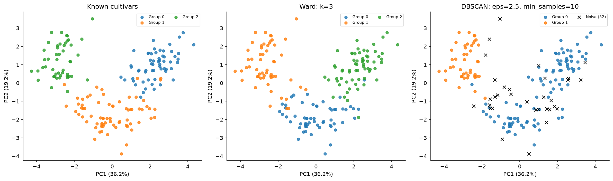

# MSCS 634 — Lab 5: Hierarchical and DBSCAN Clustering

**Student:** Minh Le  
**Course:** Advanced Big Data and Data Mining (MSCS-634-M50), Fall 2026

## Purpose
Explore hierarchical and density-based clustering using scikit-learn's Wine dataset
(178 observations, 13 chemical features). The notebook includes data exploration,
standardization, parameter experiments, scatter plots, a dendrogram, evaluation,
and written analysis.

## Files
- `MSCS_634_Lab_5.ipynb`: executed notebook with figures, tables, and interpretation.
- `results/`: six figures, parameter metrics, comparison tables, and sample assignments.
- `requirements.txt`: exact package versions used with Python 3.13.2.
- `build_notebook.py`: regenerates and executes the notebook.

## Method and results
Both algorithms use all 13 standardized features. PCA is used only for plotting;
the two displayed components retain **55.41%** of variance. True cultivar labels are
used only for external evaluation and reference plots, not for fitting or selection.

Ward clustering tests 2–6 groups; 3 groups have the highest silhouette. DBSCAN tests
15 combinations of `eps` (1.5–3.5) and `min_samples` (3, 5, 10). Its representative
run maximizes assigned-sample silhouette among configurations with at least two
real clusters and at least 70% coverage. This coverage cutoff is an illustrative heuristic.

| Representative model | Clusters | Noise | Coverage | Silhouette* | Homogeneity** | Completeness** |
|---|---:|---:|---:|---:|---:|---:|
| Ward, `n_clusters=3` | 3 | 0 | 100.0% | 0.2774 | 0.7904 | 0.7825 |
| DBSCAN, `eps=2.5`, `min_samples=10` | 2 | 32 | 82.0% | 0.3228 | 0.5045 | 0.5604 |

\* Silhouette uses assigned samples, so the rows use different sample sets. The
notebook also compares both labelings on the same DBSCAN-assigned subset.
On those same 146 observations, Ward's silhouette is **0.3491**, compared with
**0.3228** for DBSCAN; this subset is still selected by DBSCAN, not independently held out.
\** Homogeneity and completeness use all 178 samples, treating DBSCAN noise (`-1`)
as a predicted category. Additional assigned-only scores are included in the notebook.

## Key insights
- **Hierarchical structure:** Ward's dendrogram jumps from a merge height of 12.57
  to 27.65. A cut between them produces three groups, supporting the silhouette result.
  Increasing to six groups raises homogeneity to 0.8348 but lowers completeness to
  0.5530 because cultivars are split across smaller groups.
- **DBSCAN sensitivity:** At `eps=1.5`, `min_samples=5` or `10`, every wine is noise.
  At `eps=2.0`, increasing `min_samples` from 3 to 5 to 10 raises noise from 64 to
  85 to 139 observations. Larger radii often merge groups: with `min_samples=10`,
  radii of 3.0 and 3.5 produce only one real cluster.
- **Coverage matters:** The highest DBSCAN silhouette in the grid is 0.3311 at
  `eps=1.5, min_samples=3`, but it excludes 147 wines. The selected DBSCAN run retains
  146 wines. Black crosses in the plots explicitly show the excluded observations.
- **Comparison:** Three Ward groups provide the more useful description of the
  cultivar structure here, with full coverage and higher all-sample homogeneity and
  completeness. DBSCAN offers explicit noise detection, but its higher silhouette
  on retained samples alone does not establish overall superiority.



## Challenges and decisions
Different feature scales required standardization. PCA made plotting possible but
omits about 44.59% of variance, so all clustering and distance evaluation remain in
13 dimensions. No missing values or duplicate feature rows were found.

DBSCAN's all-noise and one-cluster outcomes require careful metric handling:
undefined silhouette scores appear as `NaN`. All-noise completeness is 1 under the
all-sample convention, which is a degenerate score, not successful clustering.
Noise is a density-based designation rather than proof of a bad data point.

This is exploratory analysis of the entire dataset, not held-out prediction.
The small parameter grid and coverage rule are explicit choices; results are not an
exhaustive optimum. Ward favors compact groups, and DBSCAN is sensitive to a global
radius in this feature space. Silhouette also favors compact separated groups.

## Reproduce
Create a Python environment, install dependencies, then regenerate the notebook:

```bash
python -m pip install -r requirements.txt
python build_notebook.py
```

Alternatively, open the notebook in Jupyter or VS Code and run all cells in order.
Install `jupyterlab` separately if desired. The Wine dataset ships with scikit-learn;
no external data download is required. Re-running overwrites generated outputs in
`results/`. PCA uses full SVD, and the clustering runs are deterministic for a fixed
input order and software environment.

## References
- [Wine dataset](https://scikit-learn.org/stable/modules/generated/sklearn.datasets.load_wine.html)
- [Clustering guide and evaluation](https://scikit-learn.org/stable/modules/clustering.html)
- [AgglomerativeClustering](https://scikit-learn.org/stable/modules/generated/sklearn.cluster.AgglomerativeClustering.html)
- [DBSCAN](https://scikit-learn.org/stable/modules/generated/sklearn.cluster.DBSCAN.html)
- [SciPy dendrogram](https://docs.scipy.org/doc/scipy/reference/generated/scipy.cluster.hierarchy.dendrogram.html)
